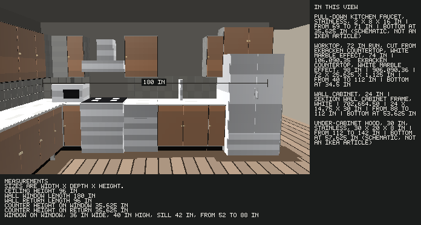
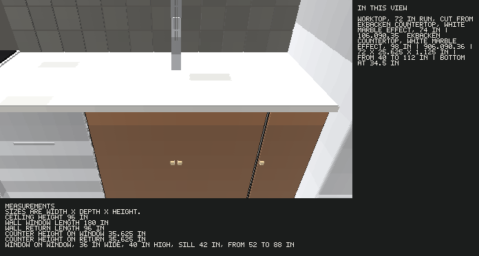
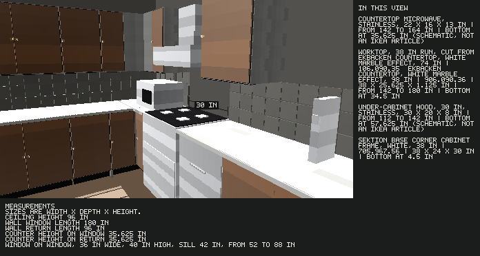

# Kitchen designer

A local kitchen planner for Canada SEKTION cabinets. Give it a measured room and it writes:

- `kitchen.glb`, a schematic 3D model
- `kitchen.stl`, the same kitchen at 1:20, ready to print
- `print/cabinets.stl`, the cabinets, fillers, and side panels on their own
- `print/kitchen-without-cabinets.stl`, the kitchen with those cabinets taken out
- `walk.html`, a first-person walkthrough you open in a browser
- `views/*.png`, stills from a 62 inch eye height
- `kitchen.usdz`, the same kitchen at real size for iPhone AR
- `ar.html`, a Safari link to that AR file
- `packet.md`, a design packet
- `bom.json`, a purchase list with IKEA.ca article numbers
- `print/products.txt`, the cabinets and products named in every other file

## Screenshots

A photo-measured L kitchen with the dark gloss front. The column on the right names what that view is aimed at. Article numbers and prices are a Canada SEKTION snapshot, not a copy of the IKEA planner.







The cabinet boxes are original geometry at the published module sizes. They are not IKEA meshes. Every file names the cabinet or product it stands for, and the same note carries the width, depth, and height, in that order, and where that piece sits on the wall. The stills and the walkthrough also draw those sizes as dimension lines. The names and measurements are on the GLB node, the USDZ mesh, the walkthrough, the stills, the AR page, and `print/products.txt`. Prices live in `data/ca_sektion.json`. `rehydrate` reads those known articles on IKEA.ca and writes a new date. A design uses the saved file and does not call IKEA.

## What it will and will not do

It places base frames, a sink cabinet, a dishwasher, a range, a fridge, a hood or an over-the-range microwave, a faucet, wall cabinets, one corner frame on an L or U, legs, hinges, a suspension rail, toe kick, exposed-end cover panels, filler strips cut from cover panels, and EKBACKEN worktop boards.

Shelves, drawers, the sink bowl, and lighting are notes, not purchase lines. Appliance bodies are schematic boxes at published opening sizes. They are drawn and listed, and they are not IKEA articles. `data/appliances.json` names the size class (a 30 inch range, a 36 inch French-door fridge) and a couple of real products that sit in that class. It does not store manufacturer meshes or prices. Fronts are AXSTAD white. Frames are white. Filler strips are ripped from FÖRBÄTTRA cover panels. A whole side panel is bought separately for each exposed cabinet end.

Look at the photo yourself. Pass `floor_color`, `wall_color`, and `surround_color` as hex, or pass `image_path` and this Mac samples the floor band, the wall band, and the top background. PNG is read directly. JPEG and other photos are converted with `sips` first. Those colors go on the floor, the walls, and a backdrop behind the kitchen in the GLB. Image bytes are not sent as a tool argument. The STL stays one material.

## Tools

`ingest_room` saves the room.

`design_kitchen` places the run and writes the model, the iPhone AR file, the STL set, the walkthrough, the stills, the packet, and the purchase list.

`export_model`, `export_packet`, `export_stl`, and `export_view` rewrite those files for a saved design.

`rehydrate_catalog` refreshes prices on the articles already in the catalog. Pass `dry_run` to preview the changes.

## Run it

```bash
PYTHONPATH=src python3 -m kitchen_designer.cli design examples/straight.json
PYTHONPATH=src python3 -m kitchen_designer.cli stl DESIGN_ID
PYTHONPATH=src python3 -m kitchen_designer.cli view DESIGN_ID
PYTHONPATH=src python3 -m kitchen_designer.cli rehydrate
PYTHONPATH=src python3 -m unittest tests.test_kitchen
```

Designs land in `designs/`. The MCP server is `bin/kitchen-designer-mcp`.

A Grok project opened in this folder picks up `.grok/config.toml`. From other folders, the same server is registered in `~/.grok/config.toml` as `kitchen-designer`. Start a new session after that change.

## Room

Sizes are inches. `straight` has one wall. `L` is a left return and then the back wall, with the corner between them. `U` adds a right return. `galley` is two parallel walls, and `room_depth_in` is the distance between those walls.

A window is `{ "kind": "window", "offset_in": 48, "width_in": 36, "sill_in": 42, "height_in": 36 }`. Offset is measured from the start of that wall. On an L or U the back wall starts at the left corner.

## Layout rules

Base frames are 30 inches high and 24 inches deep, on 4 1/2 inch legs. The worktop in the model is 1 1/8 inches thick. Wall cabinets sit 18 inches above it. The corner base occupies 38 inches on each wall. The corner wall cabinet occupies 26 inches, and a 12 inch wall frame fills the rest of the base corner when that frame exists.

The fridge goes at an end of the appliance wall, on the side that still fits the sink, dishwasher, and range. A fridge against a wall keeps 4 inches of filler. A door cabinet against a wall keeps 2 inches. A range can sit flush to a wall. The sink sits under the widest window it fits. The dishwasher sits beside the sink. The range takes the largest remaining gap. Leftover gaps are filler strips, cut from cover panels.

## Appliances

Preferences on `design_kitchen`:

| Field | Default | Choices |
| --- | --- | --- |
| `fridge_style` | `french-door` | `french-door`, `top-freezer` |
| `fridge_width_in` | 36 for French door, 30 for top freezer | French door 36 or 30. Top freezer 30 or 28 |
| `range_width_in` | 30 | 28, 30, 36 |
| `finish` | `stainless` | `stainless`, `white`, `black` |
| `vent` | `hood` | `hood`, `otr` (microwave in place of the hood), `none` |
| `faucet` | `pull-down` | `pull-down`, `bridge`, `single`, `none` |
| `microwave` | `auto` | `auto`, `counter`, `none`. A counter microwave is listed even when no open counter is long enough |
| `print_scale` | 20 | 8 to 40. This is the 1:N scale. 20 prints a 12 foot wall at about 183 mm |

The hood body matches the range width. The closest catalog hood supplies the name. A countertop microwave needs a clear run at least as wide as the microwave, and it stays off the worktop purchase.

## Print

`print_scale` 20 means 1:20. `kitchen.stl` is the whole room. `print/cabinets.stl` is the cabinet shells, the filler strips, and the side panels, so those can be left out of a print. `print/kitchen-without-cabinets.stl` is the floor, walls, appliances, fittings, and worktops. Cabinet shells are open at the front. Anything thinner than about 1.6 mm is thickened to that.

## First person

`walk.html` opens in a browser. Click the picture, then walk with WASD and look with the mouse. Eye height is 62 inches. The keys 1, 2, and 3 jump to the saved stills. Those stills are `views/facing.png` (the whole run), `views/along.png` (down the cabinets), and a third picture at the sink or the range. The walk adds floor beyond the short pad in the GLB so you can stand back and see the run. The GLB and the STL keep that shorter floor. The same colors used on the floor, walls, and backdrop are in the pictures.

## iPhone AR

`kitchen.usdz` is the kitchen at real size. AirDrop it to an iPhone, tap the file, then tap AR and set it on the floor. Pinch to scale. Quick Look opens it. There is no separate app. A 12 foot run is about 3.7 meters wide, so pinch it down if you want it on a table.

`ar.html` links to the same file. Safari draws the AR button on the picture when the page is served over HTTPS. AirDrop, Messages, and Mail are the reliable way to hand the file to the phone. The boxes are the same schematic geometry as the GLB, and the floor sits on the detected ground.
